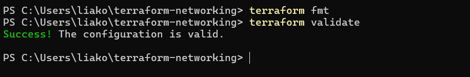
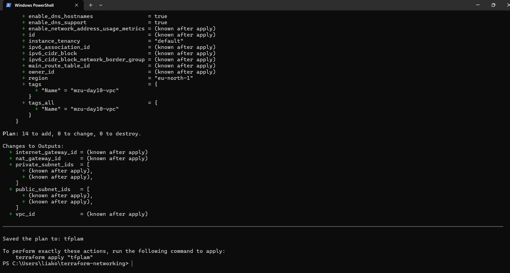
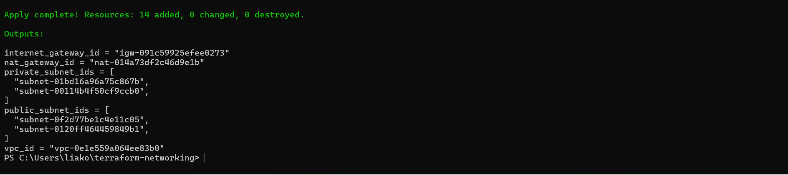
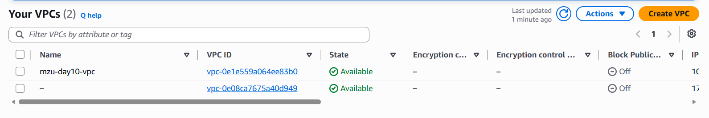
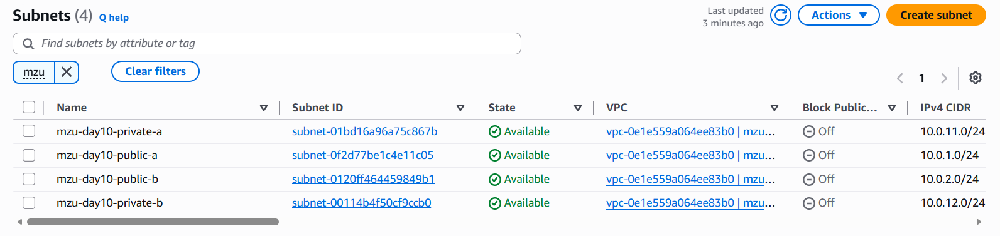
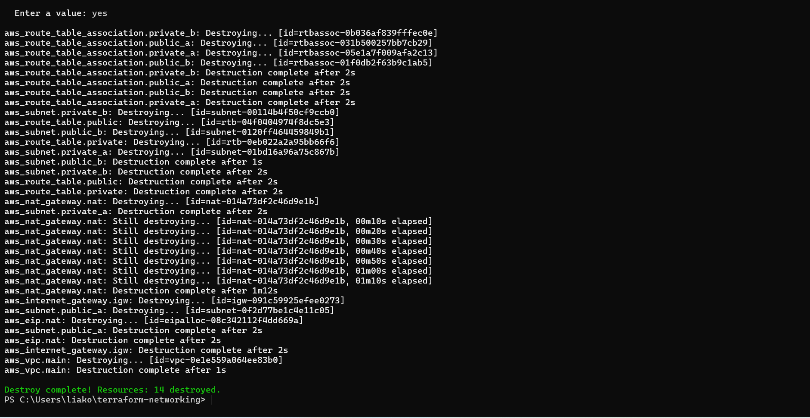

# Terraform AWS Networking - MZ-UCA Day 10

## Project Overview

This project demonstrates the deployment of a multi-tier AWS network using Terraform. The infrastructure includes public and private subnet tiers, controlled routing, an Internet Gateway, and NAT-based outbound connectivity for private resources.

## Architecture

```
AWS VPC - 10.0.0.0/16
|
├── Public Subnet A - 10.0.1.0/24
├── Public Subnet B - 10.0.2.0/24
|
├── Private Subnet A - 10.0.11.0/24
├── Private Subnet B - 10.0.12.0/24
|
├── Internet Gateway
├── Public Route Table
|     └── 0.0.0.0/0 -> Internet Gateway
|
├── NAT Gateway
|
└── Private Route Table
      └── 0.0.0.0/0 -> NAT Gateway
```

## Technologies Used

Terraform • AWS • AWS CLI • Visual Studio Code • Git • GitHub

## AWS Resources Created

VPC • two public subnets • two private subnets • Internet Gateway • Elastic IP • NAT Gateway • public route table • private route table • route-table associations

## Network Design

**Public tier:** the public subnets use a route table with a default route to the Internet Gateway.
**Private tier:** the private subnets have no direct route to the Internet Gateway; outbound traffic uses the NAT Gateway.

## Terraform Workflow

```
terraform init
terraform fmt
terraform validate
terraform plan -out=tfplan
terraform apply tfplan
terraform output
terraform state list
terraform destroy
```

## Evidence (embedded screenshots)








## Key Learning Outcomes

Infrastructure as Code • AWS VPC design • CIDR planning • public and private subnet design • Internet Gateway routing • NAT Gateway routing • Terraform resource dependencies • state inspection • infrastructure validation • infrastructure documentation

## Security Notes

No AWS credentials or secrets are stored in this repository. Terraform state files and local Terraform working directories are excluded from Git.

## Cleanup

```
terraform destroy
```

## Author

Liako Khumalo - MZ-UCA Cloud Academy

## Engineering Questions

**Why does the VPC need an Internet Gateway?**
A VPC is a private, isolated network. Nothing inside it can reach the internet by default. The Internet Gateway is the door between the VPC and the internet. The public route table sends all outside traffic (0.0.0.0/0) to it, so the public subnets can send and receive internet traffic.

**Why must the NAT Gateway sit in a public subnet?**
The NAT Gateway needs its own path to the internet so it can send traffic out for the private subnets. Only a public subnet has that path, because only the public route table points to the Internet Gateway. Private traffic goes to the NAT Gateway, then out through the Internet Gateway, and replies come back the same way. In a private subnet, the NAT Gateway would have no way out.
>>>>>>> f5885a5 (feat: build AWS VPC network with Terraform)

### Infrastructure Cleanup


